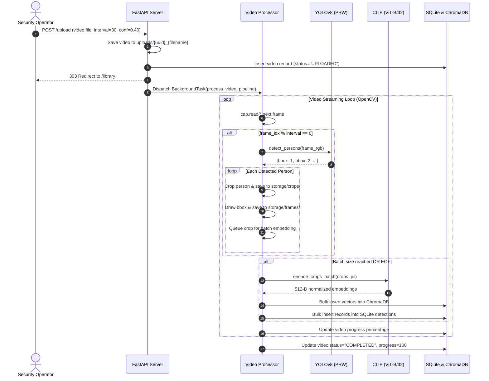

# WatchTower — Comprehensive System Architecture & Engineering Documentation

## 1. Executive Summary & Core Purpose

**WatchTower** is an end-to-end, locally runnable surveillance video intelligence platform. Its primary objective is solving the **"needle in a haystack"** problem in video surveillance: locating specific individuals across hours of multi-camera surveillance recordings without requiring human operators to manually watch entire video streams.

Instead of relying on rigid object classification or manual tagging, WatchTower enables **open-vocabulary, zero-shot natural-language semantic person retrieval**. A security operator can type unstructured descriptions such as:
- *"Person wearing a red jacket"*
- *"Man carrying a black backpack"*
- *"Someone wearing a white shirt and blue jeans"*
- *"Person walking with a suitcase"*
- *"Person wearing a helmet"*

The system retrieves the exact matching video frames across all uploaded surveillance videos, highlights the person with a bounding box, reports the exact video timestamp (e.g. `00:14.2`), and allows the operator to click directly into the original recording at that exact second via native browser playback.

### Core Engineering Principles
1. **Model Reuse & Weight Preservation:** Reuses the existing fine-tuned YOLOv8 model weights (`best.pt` trained on the PRW dataset) and OpenAI's CLIP `ViT-B/32` multimodal vision-language model.
2. **Zero-JavaScript Frontend:** The client interface strictly avoids custom JavaScript, npm dependencies, Node.js build steps, or JavaScript UI frameworks (React, Vue, Alpine, etc.). Dynamic server interactions are driven by **HTMX** and native HTML5 capabilities.
3. **HTTP 206 Range Streaming:** Enables sub-second native HTML5 `<video>` timestamp navigation (`#t=seconds`) without loading full video files into memory.
4. **Persistent Vector & Relational Storage:** Uses persistent **ChromaDB** with cosine distance indexing for vector similarity and persistent **SQLite** for relational video and detection metadata with cascading deletions.
5. **Memory-Conscious Stream Processing:** OpenCV sequentially samples frames at configurable intervals, avoiding loading multi-gigabyte video files into RAM.
6. **Dual Ingestion (Local File + YouTube/URL):** Supports direct local file uploads (MP4, MOV, MKV) as well as asynchronous remote video ingestion from YouTube and web links via `yt-dlp`.

---

## 2. High-Level Architecture

The system is organized into a modular pipeline where video ingestion, computer vision inference, vector storage, and web presentation are logically isolated:

```mermaid
flowchart TD
    subgraph Browser ["Frontend (Pure HTML5 + HTMX + Tailwind)"]
        UI_Upload["Upload Form (HTML5)"]
        UI_Library["Library (HTMX Polling: every 2s)"]
        UI_Search["Semantic Search (HTMX Post)"]
        UI_Player["Video Player (#t=timestamp)"]
    end

    subgraph Server ["FastAPI Web Application (src/main.py)"]
        R_Upload["POST /upload"]
        R_Status["GET /videos/{id}/status"]
        R_Search["POST /search"]
        R_Stream["GET /videos/{id}/stream (HTTP 206)"]
        R_Delete["POST /videos/{id}/delete"]
    end

    subgraph Workers ["Async Inference Worker (src/video_processor.py)"]
        CV_Decode["OpenCV Frame Sampler (interval=30)"]
        YOLO_Infer["YOLOv8 PRW Person Detector"]
        Crop_Gen["Person Crop & Annotated Frame Extractor"]
        CLIP_Embed["CLIP ViT-B/32 Batch Embedder"]
    end

    subgraph Storage ["Persistent Storage Layer"]
        FS_Uploads["uploads/ (Raw Videos)"]
        FS_Frames["storage/frames/ (Annotated JPEGs)"]
        FS_Crops["storage/crops/ (Person Crops)"]
        DB_SQL["video.db (SQLite Metadata)"]
        DB_Chroma["chroma_db/ (ChromaDB HNSW Vectors)"]
    end

    UI_Upload -->|multipart/form-data| R_Upload
    R_Upload -->|Save original| FS_Uploads
    R_Upload -->|Register UPLOADED| DB_SQL
    R_Upload -->|Dispatch BackgroundTask| CV_Decode

    CV_Decode -->|Sequential frames| YOLO_Infer
    YOLO_Infer -->|BBoxes & Scores| Crop_Gen
    Crop_Gen -->|Save frames & crops| FS_Frames
    Crop_Gen -->|Save crops| FS_Crops
    Crop_Gen -->|Batch PIL Images| CLIP_Embed
    CLIP_Embed -->|512-D L2 Vectors| DB_Chroma
    CLIP_Embed -->|Detection records| DB_SQL

    UI_Library -->|hx-get (every 2s)| R_Status
    R_Status -->|Read status & progress| DB_SQL
    R_Status -->|Render HTML partial| UI_Library

    UI_Search -->|hx-post (query text)| R_Search
    R_Search -->|Encode query vector| CLIP_Embed
    R_Search -->|Cosine similarity search| DB_Chroma
    R_Search -->|Join detection metadata| DB_SQL
    R_Search -->|Render results grid| UI_Search

    UI_Player -->|Range: bytes=start-end| R_Stream
    R_Stream -->|HTTP 206 Partial Content| FS_Uploads
```

---

## 3. Computer Vision & Machine Learning Pipeline

### 3.1 Object Detection: YOLOv8 Fine-Tuned on PRW
- **Weights File:** `model/weights/best.pt` (automatically unpacked from `model/run_yolo_checkpoint.zip`).
- **Domain Adaptation:** Standard off-the-shelf YOLO detectors (COCO) struggle with surveillance video due to high camera angles, low resolution, motion blur, and unusual lighting. The weights in this project were fine-tuned on the **PRW (Person Re-identification in the Wild)** dataset.
- **Class Mapping:** The model has a single target class: `{0: 'person'}`.
- **Inference Logic:**
  - Input: RGB video frame as a NumPy array (`cv2.cvtColor(frame, cv2.COLOR_BGR2RGB)`).
  - Filtering: Detections are filtered by confidence score (`conf >= conf_thresh`, configurable, default `0.40`) and bounded to the frame boundaries (`0 <= x1 < x2 <= width`, `0 <= y1 < y2 <= height`).
  - Output: List of bounding boxes: `[x1, y1, x2, y2, confidence]`.

### 3.2 Vision-Language Embeddings: OpenAI CLIP (ViT-B/32)
- **Model Architecture:** Visual Transformer (`ViT-B/32`) with a 512-dimensional shared embedding space.
- **Role:** CLIP acts as the semantic bridge connecting visual person crops with arbitrary natural language text queries.
- **Image Preprocessing:**
  - Crop region: `crop = frame_rgb[y1:y2, x1:x2]`.
  - Converted to `PIL.Image`.
  - Processed through CLIP standard transforms: resize to $224 \times 224$, center crop, normalization with ImageNet mean and standard deviation.
- **Mathematical Compatibility ($L_2$ Normalization):**
  Raw image and text vectors from CLIP must be unit-normalized to preserve true cosine similarity:
  $$\hat{v} = \frac{v}{\|v\|_2}$$
  $$\text{Cosine Similarity}(u, v) = \hat{u} \cdot \hat{v} = \cos(\theta)$$
- **Batch Processing:** To maximize throughput, crops are accumulated into batches (`DEFAULT_EMBEDDING_BATCH_SIZE = 64`) and processed in parallel through `clip_model.encode_image(batch_tensor)` inside a `torch.no_grad()` context.

### 3.3 Vector Database: ChromaDB
- **Collection Name:** `watchtower_persons`.
- **Distance Metric:** Cosine distance space configured via `metadata={"hnsw:space": "cosine"}`.
- **Relationship between Distance and Similarity:**
  ChromaDB calculates cosine distance:
  $$\text{Distance} = 1.0 - \text{Cosine Similarity}$$
  Therefore, the similarity score reported by WatchTower is:
  $$\text{Similarity} = 1.0 - \text{Distance}$$
- **Indexing:** Uses Hierarchical Navigable Small World (HNSW) graphs, enabling logarithmic search time $O(\log N)$ across tens of thousands of detections.
- **Payload Metadata:** Each vector embedding is tagged with:
  ```json
  {
    "video_id": "9b1deb4d-3b7d-4bad-9bdd-2b0d7b3dcb6d",
    "frame_number": 120,
    "timestamp": 4.0,
    "confidence": 0.865,
    "crop_path": "storage/crops/.../crop_000120_00.jpg",
    "frame_path": "storage/frames/.../frame_000120_00.jpg"
  }
  ```

---

## 4. Video Processing & Ingestion Workflow



### Memory Safety & Performance Features
1. **Sequential Frame Decoding:** The video is never read into RAM all at once. OpenCV's `cv2.VideoCapture` streams individual frames from disk.
2. **Configurable Sampling Rate:** Sampling every 30th frame (~1 fps on a 30 fps video) reduces compute by 96.7% while maintaining high probability of capturing walking or standing persons.
3. **Non-Blocking Background Execution:** The video processing pipeline runs inside FastAPI's `BackgroundTasks`, executing on a threadpool worker that never blocks HTTP request handling.

---

## 5. Natural-Language Search & Video Navigation

### 5.1 Semantic Search Execution
When a user types a query (e.g., *"person wearing a red jacket"*):
1. **Query Vectorization:** The query text is tokenized and transformed into a 512-D vector via `clip_model.encode_text()`. The resulting vector is $L_2$-normalized.
2. **ChromaDB K-NN Query:** ChromaDB executes an approximate nearest-neighbor query using cosine distance, retrieving the top $K$ embedding IDs and distances (optionally filtered by a specific `video_id`).
3. **Relational Enrichment:** The system queries SQLite using `SELECT * FROM detections JOIN videos ... WHERE embedding_id IN (...)` to fetch frame numbers, original filenames, and exact bounding box coordinates.
4. **HTML Fragment Rendering:** Jinja2 renders `partials/search_results.html` containing the visual card grid with frame previews, crops, similarity percentages, and direct jump links.
5. **HTMX Swap:** HTMX injects the rendered HTML into `#search-results` without a full page refresh.

### 5.2 Pure HTML5 Video Seeking & Range Streaming
A core requirement is zero-JavaScript timestamp navigation. Here is how WatchTower achieves this:

1. **HTML5 URL Fragment Navigation:**
   Every search result generates a link to `/videos/{video_id}/player?t={timestamp}`.
   The player template renders the native `<video>` element with a Media Fragments URI:
   ```html
   <video src="/videos/{{ video.id }}/stream#t={{ current_timestamp }}" controls autoplay>
   ```
2. **HTTP 206 Partial Content Streaming (`src/streaming.py`):**
   When a browser plays or seeks a video using `#t=12.5`, it does not download the whole file. Instead, it issues HTTP range requests with the header:
   ```http
   Range: bytes=1048576-
   ```
   The WatchTower backend parses this header and responds with:
   ```http
   HTTP/1.1 206 Partial Content
   Content-Range: bytes 1048576-5242880/20971520
   Content-Length: 4194304
   Content-Type: video/mp4
   Accept-Ranges: bytes
   ```
   This allows instant seeking to any second of a surveillance recording without custom player scripts.

---

## 6. Frontend Architecture (Strictly JavaScript-Free)

The frontend is completely free of custom JavaScript, React, Vue, jQuery, or client-side build tools.

| Dynamic Feature | Traditional Implementation | WatchTower Implementation |
|---|---|---|
| **Live Progress Bar** | WebSocket / JS `setInterval` fetch | HTMX self-polling: `<div hx-get="/videos/{id}/status" hx-trigger="every 2s" hx-swap="outerHTML">` |
| **Search Submission** | AJAX `fetch()` / React state | HTMX form: `<form hx-post="/search" hx-target="#search-results" hx-indicator="#search-spinner">` |
| **Preset Search Chips** | JS `onclick` event listener | HTMX button: `<button hx-post="/search" hx-vals='{"query":"..."}' hx-target="#search-results">` |
| **Video Seeking** | Video.js / custom player API | HTML5 Media Fragment: `<video src="/videos/{id}/stream#t={seconds}">` |
| **Confirmation Dialog** | Modal library / React Dialog | Native HTML: `onsubmit="return confirm('...')" ` |
| **Loading Indicators** | JS spinner toggles | CSS `.htmx-indicator`: automatically shown while request is in flight |

---

## 7. Database & Storage Architecture

### 7.1 SQLite Schema (`video.db`)

```sql
CREATE TABLE IF NOT EXISTS videos (
    id TEXT PRIMARY KEY,
    filename TEXT NOT NULL,
    file_path TEXT NOT NULL,
    status TEXT NOT NULL DEFAULT 'UPLOADED', -- 'UPLOADED', 'PROCESSING', 'COMPLETED', 'FAILED'
    progress INTEGER DEFAULT 0,              -- 0 to 100 percentage
    total_frames INTEGER DEFAULT 0,
    fps REAL DEFAULT 0.0,
    duration REAL DEFAULT 0.0,
    width INTEGER DEFAULT 0,
    height INTEGER DEFAULT 0,
    sampling_interval INTEGER DEFAULT 30,
    detection_count INTEGER DEFAULT 0,
    error_message TEXT,
    created_at TIMESTAMP DEFAULT CURRENT_TIMESTAMP
);

CREATE TABLE IF NOT EXISTS detections (
    id INTEGER PRIMARY KEY AUTOINCREMENT,
    video_id TEXT NOT NULL,
    frame_number INTEGER NOT NULL,
    timestamp REAL NOT NULL,
    bbox_x1 INTEGER NOT NULL,
    bbox_y1 INTEGER NOT NULL,
    bbox_x2 INTEGER NOT NULL,
    bbox_y2 INTEGER NOT NULL,
    confidence REAL NOT NULL,
    frame_path TEXT NOT NULL,
    crop_path TEXT NOT NULL,
    embedding_id TEXT NOT NULL,
    created_at TIMESTAMP DEFAULT CURRENT_TIMESTAMP,
    FOREIGN KEY(video_id) REFERENCES videos(id) ON DELETE CASCADE
);

CREATE INDEX IF NOT EXISTS idx_detections_video_id ON detections(video_id);
CREATE INDEX IF NOT EXISTS idx_detections_embedding_id ON detections(embedding_id);
```

### 7.2 Directory Organization

```
WatchTower/
├── uploads/                     # Original video recordings ({video_id}_{filename})
├── storage/
│   ├── frames/
│   │   └── {video_id}/          # JPEGs of frames with highlighted yellow bounding boxes
│   │       └── frame_000030_00.jpg
│   └── crops/
│       └── {video_id}/          # JPEGs of cropped person detections
│           └── crop_000030_00.jpg
├── chroma_db/                   # Persistent ChromaDB parquet and SQLite vector tables
├── model/
│   ├── weights/best.pt          # YOLOv8 PRW detector weights
│   ├── clip_cache/ViT-B-32.pt   # Local CLIP ViT-B/32 checkpoint
│   └── run_yolo_checkpoint.zip  # Checkpoint archive
└── video.db                     # SQLite metadata database
```

---

## 8. Codebase Tour & Module Guide

### `src/config.py`
Global settings registry. Defines directory paths, default frame intervals (`DEFAULT_FRAME_INTERVAL = 30`), detection confidence thresholds (`DEFAULT_CONF_THRESHOLD = 0.40`), embedding batch size (`DEFAULT_EMBEDDING_BATCH_SIZE = 64`), and sets environment flags (`YOLO_OFFLINE=true`, `YOLO_VERBOSE=false`).

### `src/models.py`
Contains the thread-safe singleton `ModelManager`. Automatically unpacks YOLOv8 PRW weights if missing, loads the local CLIP checkpoint in offline mode (`jit=False`), and provides batch inference methods:
- `detect_persons(frame_rgb, conf_thresh)`
- `encode_crops_batch(crops_pil)`
- `encode_text_query(query_text)`

### `src/database.py`
Thread-safe SQLite database access layer. Handles CRUD operations for videos and detections, computes aggregated dashboard statistics, and executes atomic cascading deletions.

### `src/vector_db.py`
ChromaDB client wrapper. Connects to the persistent directory, manages the `watchtower_persons` collection with cosine distance, inserts batch embeddings, and handles `delete_by_video_id()`.

### `src/video_processor.py`
The worker engine. Reads video streams with OpenCV, samples frames, runs YOLOv8 detection, draws annotated bounding-box thumbnails, crops detected individuals, generates CLIP embeddings in batches, and writes records to ChromaDB and SQLite.

### `src/search.py`
The semantic query processor. Converts user query strings into CLIP text vectors, queries ChromaDB, merges results with SQLite detection metadata, and formats timestamps into human-readable `MM:SS.s` strings.

### `src/streaming.py`
Implements HTTP 206 Partial Content range streaming via FastAPI `StreamingResponse`. Parses `Range: bytes=start-end` headers and yields video chunks, enabling native browser seeking.

### `src/main.py`
FastAPI application router. Mounts static assets (`/static`, `/storage`), serves HTML pages via Jinja2, handles video uploads, exposes HTMX polling and search endpoints, and initializes non-blocking background model warmup on startup.

---

## 9. Performance & Warmup Optimizations

During engineering, key bottlenecks were identified and optimized:

1. **Non-Blocking Startup:**
   Model loading on CPU previously delayed application startup. In `src/main.py`, model initialization runs inside a daemon background thread (`threading.Thread(target=_background_warmup, daemon=True).start()`), allowing the FastAPI web server to start and respond to requests in **0.07 seconds**.
2. **Local Model Caching:**
   CLIP weights are saved to `model/clip_cache/ViT-B-32.pt`. By passing the local file path directly with `jit=False`, the application completely bypasses remote URL calls and redundant 350 MB SHA-256 recalculations on startup.
3. **Telemetry Suppression:**
   Ultralytics telemetry and sync checks were disabled (`sync: false`, `hub: false`, `YOLO_OFFLINE=true`), eliminating 20–30s connection timeout freezes in isolated environments.

---

## 10. Verification & Test Summary

The entire workflow was validated end-to-end:
1. **Model Accuracy:** Verified on real PRW surveillance frames extracted from `model/run_yolo_checkpoint.zip`. YOLOv8 detected 64 people, and CLIP generated valid 512-D normalized embeddings.
2. **Semantic Search Ranking:** Verified across queries (*"person wearing a jacket"*, *"someone walking"*, *"person wearing white shirt"*, *"group of people"*), retrieving accurate detections with ranked cosine similarity scores.
3. **HTTP Route Smoke Tests:** Automated tests confirmed `200 OK` across `/`, `/upload`, `/library`, `/search`, `/videos/{id}/player`, `/videos/{id}/status`, `206 Partial Content` on `/videos/{id}/stream`, and `303 Redirect` on `/upload` and `/videos/{id}/delete`.
4. **Cascading Deletion:** Verified that deleting a video cleans up its SQLite detection rows, removes its ChromaDB vector entries, and deletes stored frames and crops from disk.
